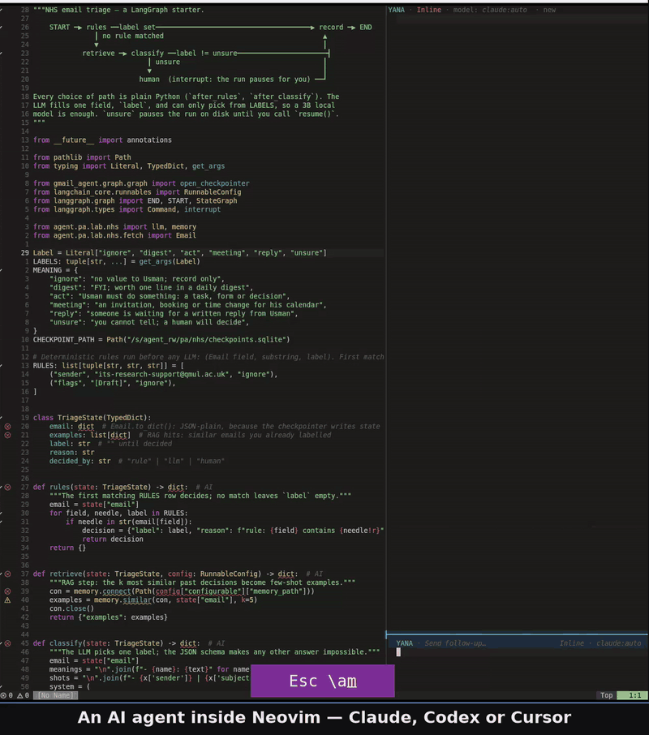

<p align="center"></p>

# Yana

Yana is a Neovim plugin for using Cursor, Claude Code, Codex or Grok in your
project. In `inline` mode, the agent's edits appear as hunks in your buffers;
you review and accept them before they reach disk.

[](assets/yana-demo.mp4)

## Features

- `ask` answers questions without writing files.
- `inline` proposes edits for review, with accept, reject, undo and redo.
- `agentic` writes files directly, without hunk review.
- Switch agent and model, stop a turn, paste images, and resume
  sessions across tabs.

[Feature details](docs/how-it-works.md)

## Install

### Prerequisites

Install Neovim 0.11.2+, Git and an agent CLI. On Linux, `ask` and `inline`
also need Python 3.11+ for the Yana tool server and ripgrep for file search.

```sh
sudo apt-get install git curl python3 ripgrep
```

Use Claude Code (`claude`), Codex (`codex`) or Grok (`grok`) for all three
modes. Cursor (`cursor-agent`) supports `agentic`. Set `backends.default`
to your agent and run `:YanaLogin` after setup to sign in.

The optional [dependency installer](scripts/install-deps.sh) checks the
prerequisites and asks before installing missing system packages.

```sh
curl -fsSLO https://raw.githubusercontent.com/drusmanbashir/yana.nvim/main/scripts/install-deps.sh
bash install-deps.sh
```

For an agentic-only setup, including on macOS, set `modes = { "agentic" }`.
See the [full installation guide](docs/installation.md).

### Neovim setup

Add this plugin declaration to lazy.nvim. Use `"codex"` as the default if you
installed Codex.
See [Usage](docs/usage.md) for key bindings and
[Configuration](docs/configuration.md) for optional settings.

```lua
{
  "drusmanbashir/yana.nvim",
  dependencies = { "drusmanbashir/yana-ui.nvim" },
  event = "VeryLazy",
  opts = { backends = { default = "claude" } },
}
```

With `opts = {}`, Yana starts with Claude.

## Use

Press `<C-a>`, enter a prompt and press `<C-s>`. Or select lines and run
`:YanaEdit` to open the instruction float. Review hunks with `ca` / `cr`, accept the
whole turn with `cA`, and undo or redo a decision with `u` / `<C-r>`.

See [all commands and keys](docs/usage.md),
[configuration and optional overrides](docs/configuration.md),
[known issues](docs/known-issues.md), [alternatives](docs/alternatives.md),
and the [roadmap](docs/roadmap.md). The full reference is `:help yana`.

## License

Apache 2.0. See [LICENSE](LICENSE) and [NOTICE](NOTICE).
